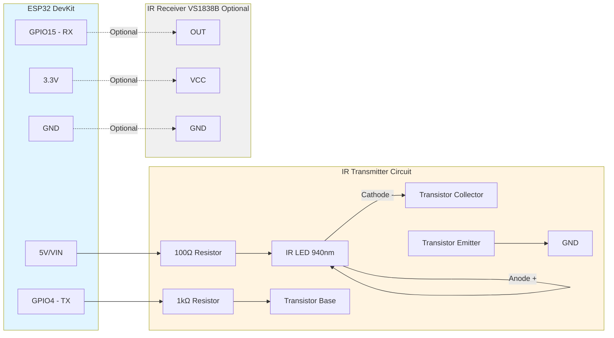

# Wiring Guide

This guide covers the electrical connections for Phase 1 (ESP32 + IR LED) of the VAir project.

## Phase 1: ESP32 IR Transmitter and Receiver

### Overview

Phase 1 uses an ESP32 development board to send infrared signals to control the Daikin air conditioner. The circuit includes:
- **IR LED transmitter** (940nm) driven by a transistor for signal strength
- **Optional IR receiver** (VS1838B) for capturing signals from the original remote

### Circuit Diagram

### Detailed Connections

#### IR Transmitter (Required)

| From | To | Notes |
|------|-----|-------|
| ESP32 VIN (5V) | 100Ω Resistor | Power for IR LED |
| 100Ω Resistor | IR LED Anode (+) | Long leg of LED |
| IR LED Cathode (-) | Transistor Collector (C) | Short leg of LED |
| Transistor Emitter (E) | GND | Complete circuit |
| ESP32 GPIO4 | 1kΩ Resistor | Signal from ESP32 |
| 1kΩ Resistor | Transistor Base (B) | Controls transistor switching |

**IR LED Current**: The IR LED will draw approximately 30mA in pulsed mode during transmission.

#### IR Receiver (Optional - for Signal Capture)

| From | To | Notes |
|------|-----|-------|
| ESP32 3.3V | VS1838B VCC | Power supply |
| ESP32 GPIO15 | VS1838B OUT | Signal input |
| ESP32 GND | VS1838B GND | Ground |

**Voltage Warning**: If using a 5V power supply for the VS1838B receiver, you must use a voltage divider on the OUT pin to reduce the signal voltage to 3.3V for the ESP32 GPIO. Alternatively, power the VS1838B with 3.3V as shown above.

### Transistor Pinout Warning

⚠️ **IMPORTANT**: TO-92 package transistors (2N2222, S8050) can have different pinout configurations:
- Some manufacturers use **E-B-C** (Emitter-Base-Collector) from left to right
- Others use **C-B-E** (Collector-Base-Emitter) from left to right

**Always verify the pinout with a multimeter before connecting!** Incorrect pinout can damage the transistor or ESP32.

### Pinout Verification with Multimeter

To identify transistor pins with a multimeter in diode test mode:

1. **Base identification**: The base will show a forward voltage (~0.6-0.7V) to both other pins in one direction
2. **Collector vs Emitter**: 
   - Red probe on base, measure both other pins → note readings
   - Generally, the emitter will show a slightly lower reading than collector
   - Confirm with transistor datasheet if available

### Testing the IR LED

The IR LED emits light invisible to the human eye. To verify it's working:

1. **Smartphone Camera Test**: 
   - Open your phone's camera app
   - Point the IR LED at the camera
   - When powered, you should see a purple/white glow on the camera screen
   - This works because smartphone cameras can detect IR light

2. **Current Test**:
   - Measure current through the circuit during transmission
   - Should see pulses around 30mA when active

### GPIO Selection Notes

#### GPIO4 (IR Transmitter)
- Standard GPIO, safe for PWM output
- Used with ESP32 RMT peripheral for precise IR timing

#### GPIO15 (IR Receiver)
- **Strapping Pin Warning**: GPIO15 is a strapping pin on ESP32
- During boot, this pin should not be pulled HIGH
- The VS1838B OUT pin is normally HIGH and goes LOW on IR signal detection
- ESPHome will show a warning about using a strapping pin, but it will work correctly
- The configuration uses `inverted: true` and `pullup: true` to handle this properly
- **Alternative pins**: If you experience boot issues, consider using GPIO16, GPIO18, or other non-strapping GPIOs

### Power Considerations

- **ESP32 Power**: Can be powered via USB (5V) or external supply (5-12V on VIN)
- **IR LED Power**: 5V from ESP32 VIN provides adequate power through the 100Ω resistor
- **Total Current**: ESP32 (~100-250mA) + IR LED pulsed (~30mA) = safe for USB power

### Physical Assembly Tips

1. **Breadboard First**: Build the circuit on a breadboard for testing before soldering
2. **IR LED Positioning**: The IR LED should have a clear line of sight to the AC unit's receiver
   - Typical range: 5-10 meters
   - Angle: Mount pointing toward the AC receiver panel
3. **Receiver Positioning**: If using the IR receiver module, position it where it can receive signals from the original remote
4. **Strain Relief**: Secure connections to prevent wire breakage, especially for permanent installations

## Phase 2 Wiring (Planned)

Phase 2 will include:
- ESP32-S3 with integrated antenna
- INMP441 I2S microphone connections
- MAX98357A I2S amplifier connections
- Speaker connections
- IR transmitter and receiver (similar to Phase 1)

**Proposed GPIO assignments** (not yet verified):
- IR TX: GPIO1 (via transistor, same as Phase 1)
- IR RX: GPIO2
- I2S Microphone: To be confirmed
- I2S Amplifier: To be confirmed

Detailed Phase 2 wiring will be added once hardware testing is complete.

## Safety Notes

- ✅ All voltages in this project are low voltage (3.3V-5V) and safe
- ✅ IR LEDs are eye-safe at these power levels
- ⚠️ Verify transistor pinout before applying power
- ⚠️ Do not exceed 50mA through the IR LED
- ⚠️ Ensure proper polarity on all components

## Troubleshooting

| Problem | Possible Cause | Solution |
|---------|---------------|----------|
| ESP32 won't boot | GPIO15 pulled HIGH | Verify receiver wiring, check inverted setting |
| No IR transmission visible on camera | LED polarity reversed | Swap LED anode/cathode |
| IR signal weak/not working | Wrong transistor pinout | Verify pinout with multimeter |
| Can't capture remote signal | Receiver not powered | Check 3.3V supply to VS1838B |
| ESP32 crashes during transmission | Insufficient power | Use powered USB hub or external supply |

---

**Last Updated**: October 26, 2026
